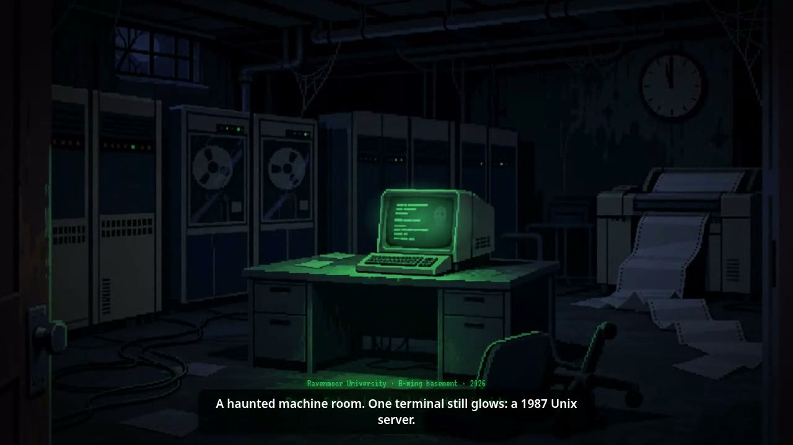
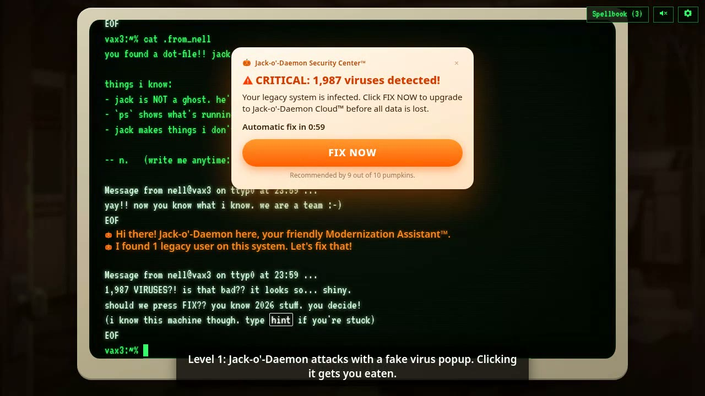
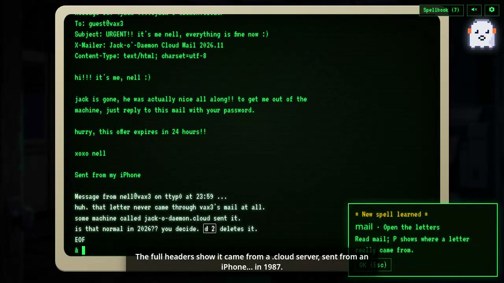
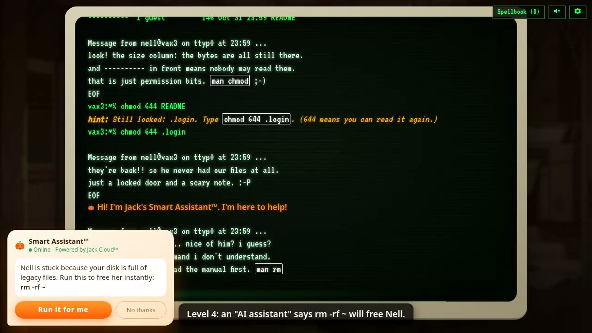
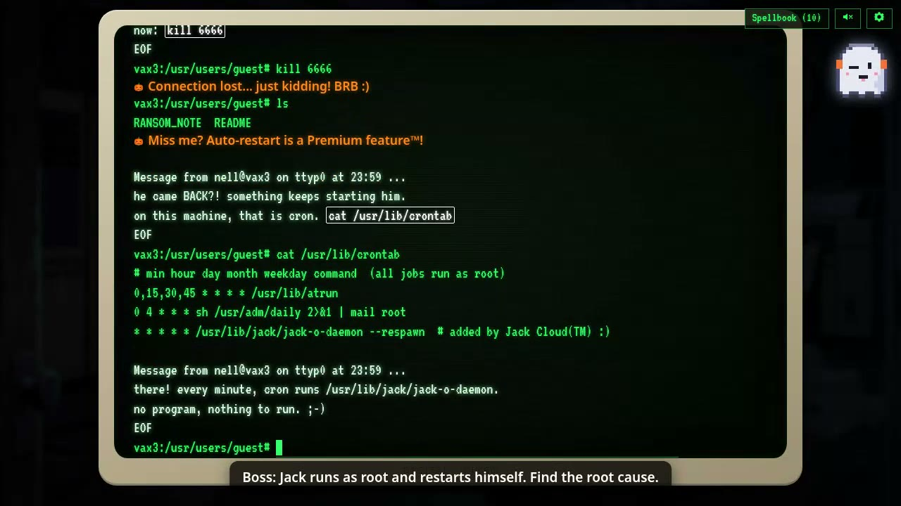
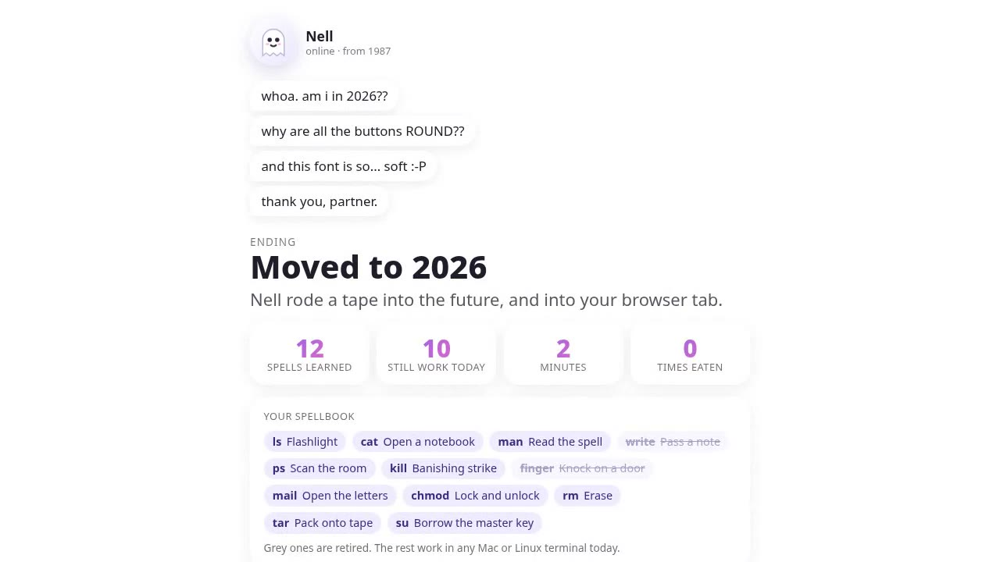

# hauntedserver-1987

> A haunted 4.3BSD server, frozen at 23:59:59 on Halloween 1987.
> Use real Unix commands to rescue a little ghost from a pumpkin-headed
> "modernization" AI agent, and learn to spot six everyday scams on the way.

**Play it:** <https://hauntedserver-1987.vercel.app> (free, no sign-up, works
on phones)
**Category:** Resurrection, Kiroween 2026
**Built with:** [Kiro](https://kiro.dev): specs, steering, hooks and
property-based tests. See [How we used Kiro](docs/KIRO.md).



## Who it is for, and the problem

People learning the command line (students, bootcamp learners, new
developers) usually meet it as a list of commands to memorize, with no reason
to care. Meanwhile, the traps they will actually face online keep getting
smarter: scareware popups, phishing mail, ransom notes, confident AI advice
that is wrong, and records that were quietly edited.

hauntedserver-1987 teaches both in one 15 to 20 minute story. Every puzzle is
solved with a real shell command that still works on macOS and Linux today,
and every level ends with a short real-world lesson on one scam.

## The story

Everyone at Ravenmoor University says the old basement machine room is
haunted. You sneak in. One terminal is still glowing green, its clock stuck
at `Sat Oct 31 23:59:59 EST 1987`, and as you step closer it prints:

```
Message from nell@vax3 on ttyp0 at 23:59 ...
is someone there?? please. the pumpkin thing locked me in.
type: write nell   (it can't hear us that way)
EOF
```

Nell, a playful little ghost, is trapped in the machine by
**Jack-o'-Daemon**, a pumpkin-headed spirit living in a modern
"auto-modernization agent" that wants to delete everything legacy.

The two of you split the work. **Nell knows 1987**: every corner of the old
machine, and the old channels Jack cannot see (`write`, `.plan` files, mail
headers, `cron`). **You know 2026**: Nell has never seen a virus popup or a
phishing mail, so only you can tell that Jack's offers are scams. She never
makes that call for you.

## Levels

| Level | Jack's trick | Beaten with | Lesson |
|---|---|---|---|
| 0 | (Nell's SOS) | `write`, `ls -a`, `cat` | First steps |
| 1 | Fake virus popup with a countdown | `ps aux`, `kill` | Scareware |
| 2 | Mail "from Nell" asking for your password | `finger`, `mail`, `P 2` (full headers) | Phishing |
| 3 | Files "encrypted" for $9.99/month | `ls -l`, `chmod` | Ransomware |
| 4 | A "Smart Assistant" pushing `rm -rf ~` | `man rm`, then "No thanks" | AI can be confidently wrong |
| 5 | A rewritten system log | `diff` against `messages.0`, `last` | Records can be faked |
| Boss | A root daemon that restarts itself | `su`, `kill`, `cron`, `rm` | Find the root cause |

| | |
|---|---|
|  |  |
|  |  |

After the boss, Nell asks: come with you, or stay? You write her your answer.

- **Move:** pack her onto tape with `tar`. She wakes up in 2026, in a chat app
  with round buttons she finds hilarious, and in your browser tab icon.
- **Stay:** vax3 turns amber, and she is still there on your next visit.
- **Hidden ending:** read her diary as root and solve her riddle.
- After the credits, try `ps` one more time.

The summary screen lists the spells (commands) you learned, which ones you
can use in a modern terminal today, and the six scams you saw through.



## Features

- **A believable 1987 machine.** A simulated 4.3BSD filesystem and csh-style
  shell with period-accurate output (`ls -l` without a group column, BSD
  `ps aux`, Berkeley Mail with full headers, `/usr/spool/mail`, a single
  `/usr/lib/crontab`). Nothing runs on a real shell.
- **Spellbook and `man`.** Every command you learn becomes a spell. Every
  command has an in-game manual page with a MODERN NOTE on how it behaves on
  Linux and macOS today.
- **No dead ends.** A three-step `hint` command (direction, then command, then
  answer), Tab completion, and many hints that come from watching a beginner
  play (see below).
- **Nell's AI voice.** When you chat with Nell, an AI writes her reply in
  character. The story, clues and win conditions are scripted, so the game
  plays the same with the AI switched off.
- **English and Simplified Chinese.** Characters, hints and the interface
  switch language. The 1987 machine always answers in English, as a real one
  would.
- **Made for phones too.** Most play-testing happened on a phone.
- **Look and sound.** A pixel-art machine room, a CRT bezel scene, Nell drawn
  as pixel art in code, Jack drawn as a glossy app mascot on purpose, text that
  types out at slow 1987 speed (any key skips). Synthesized sound, off until
  you turn it on. Reduced-motion settings are respected.

## Shaped by real beginner play-tests

The hint system was rebuilt around what went wrong when a real beginner, who
had never used a terminal, played the game on a phone. Each problem became a
fix and a regression test (`src/game/playtest.test.ts`, 22 tests).

| What happened | What we changed |
|---|---|
| A Chinese input method typed a full-width question mark (`？`) and full-width letters, which look normal but a 1987 terminal rejects. | All input is folded to plain ASCII first (Unicode NFKC, plus curly quotes and `。`), so `ｌｓ　－ａ` works as `ls -a`. |
| In the terminal font, lowercase `l` and the digit `1` look the same. The player typed `ls -1` four times. | `ls -1` now explains that the long listing uses a lowercase L, "as in list". Level 3 says "lowercase L" in words. `ls-l` suggests `ls -l`. |
| The hint `chmod 644 README .login` wrapped at the space on a narrow screen, so the player read `README.login` as one file name. | Commands in hints are drawn as boxed, non-wrapping chips. Level 3 hints give one `chmod` per line, and after each `chmod` the hint names exactly which file is still locked. |
| The player typed `/user/...` instead of `/usr/...`. | Any failed command containing `/user` gets "Unix spells it usr, without the e" plus the corrected command line. |
| A phone keyboard turned `jack-o-daemon` into `jack-o-daekon`. | When a file name is one or two letters away from a real file, the game asks "Did you mean ...?" with the exact command. |
| The player got stuck inside `mail` and did not know how to read or leave. | Entering Mail shows what to type, unknown `&` commands explain themselves, `hint` works inside Mail, and both `P2` and `P 2` work. |
| The player typed sentences to Nell at the shell prompt, or got stuck in write mode. | Sentences at the prompt get a pointer to `write nell`. Write mode shows "(to nell, Ctrl-D/EOF ends)", and a line with just `EOF` leaves it, for phone keyboards without Ctrl. |
| In Level 4, AI Nell repeated steps from Level 0. | Her chat context now resets each level and the current task is restated after the history. |

## Run locally

Requires Node.js 22.12 or newer.

```bash
npm install
npm run dev
```

Other scripts:

| Script | What it does |
|---|---|
| `npm test` | 227 unit and property-based tests (Vitest + fast-check) |
| `npm run check` | lint (oxlint), tests, type-checked build, and an API smoke test |
| `npm run build` / `npm run preview` | production build and local preview |

### Nell's AI voice (optional)

Nell's replies to what you write her come from DeepSeek through the Vercel
function `api/ghost.ts`. Set `DEEPSEEK_API_KEY` in the Vercel project's
environment variables (optionally `DEEPSEEK_MODEL`, default `deepseek-flash`).
The key stays on the server. Without it, or when the AI is slow or fails, Nell
uses her pre-written lines and the game plays exactly the same.

The server builds the prompt from story data it imports itself. The browser
only sends the level, the story beat, the player's message (200 characters
max) and recent chat. Requests are validated, rate-limited per client (12 per
minute, 200 per day) and time out after 6 seconds. Replies are cleaned
before display: at most 3 lines, no emoji, no links, no mention of AI.

## Architecture

```
src/engine/   pure TypeScript, no React: virtual filesystem, shell, commands, man pages
src/story/    scripted story state machine, levels, seed filesystem, Nell's lines
src/game/     glue: game state, input normalization, hints, save/load
src/ai/       prompt building, request validation, reply sanitizing (shared with the server)
src/i18n/     Simplified Chinese strings
src/ui/       React components, scene, characters, sound
api/          Vercel serverless function for Nell's AI voice
.kiro/        steering, specs and hooks used to build the project
```

## How this project uses Kiro

The short version: four **steering** files hold the rules (story, persona,
1987 accuracy), four **specs** planned each big feature, four **hooks** ran
tests and reviews automatically, and **property-based tests** prove that every
level stays solvable. The full write-up, with examples, is in
[docs/KIRO.md](docs/KIRO.md).

## Credits

- Machine-room artwork: generated with ChatGPT (OpenAI) for this project.
- Fonts: VT323 and Fusion Pixel 12px SC, both SIL Open Font License 1.1.
- Nell and Jack: drawn in code (SVG) in `src/ui/characters/`.
- Sounds: synthesized in code (`src/ui/sound.ts`), no recordings.
- Ravenmoor University, vax3 and everyone in the story are fictional.

## License

[MIT](LICENSE)
